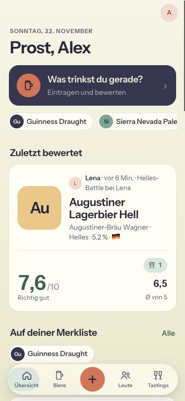
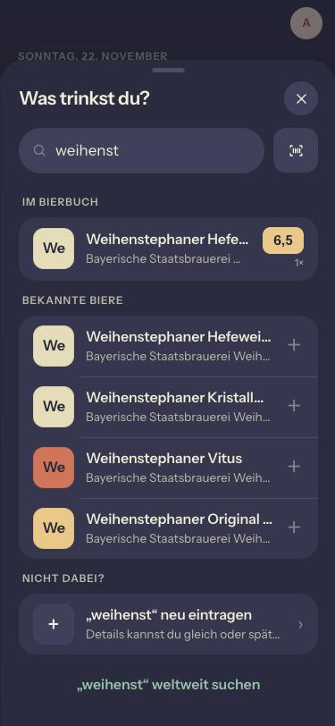
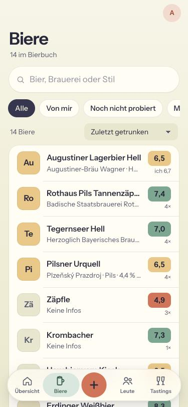
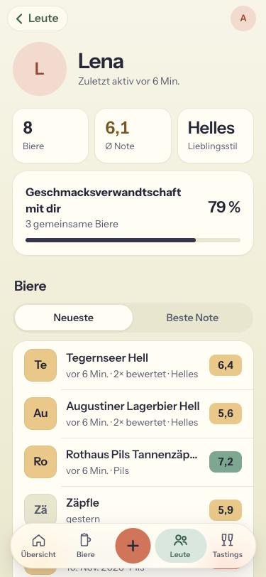

# 🍺 Bierstudio

**Dein Bierbuch, mit deinen Leuten.** Trag ein, was du gerade trinkst, gib eine Note und sieh, was die anderen davon halten. Eine selbst gehostete Web-App für Docker oder TrueNAS SCALE, die sich auf dem Handy als App installieren lässt.

<p align="center">
  
  
  
  
</p>

## Funktionen

**Schnell eintragen**
- Ein Tipp auf **＋** oder „Was trinkst du gerade?“, Name tippen, Note ziehen, fertig.
- **Erkennt Biere zuverlässig**: Tippfehler („Guiness“), Spitznamen („Zäpfle“, „Sterni“), Umlaute, Wortreihenfolge und Schreibvarianten („Pilsener“/„Pils“, „Hefeweißbier“/„Weizen“) landen beim selben Bier.
- Bevor ein neues Bier angelegt wird, fragt die App „Meinst du eins davon?“. Bereits entstandene **Doppelte** findet sie selbst und führt sie auf Wunsch zusammen (mit Rückgängig).
- Zuletzt getrunkene Biere stehen als Schnellwahl bereit.

**Übersicht und Leute**
- **Startseite** mit dem zuletzt bewerteten Bier, allem, was davor getrunken wurde, und der Bestenliste.
- **Leute**: Jede Person hat ihre Seite mit allen Bieren, Noten, Lieblingsstil, Notenverteilung und der Geschmacksverwandtschaft zu dir.
- **Biere**: Suche, Filter (von mir, noch nicht probiert, Favoriten) und Sortierung.

**Tastings, wenn ihr zusammensitzt**
- Alle per **QR-Code** einladen, ohne Konten oder Passwörter.
- Ein Bier **„ins Glas“** setzen: Alle Handys springen dorthin.
- Optional **blind**: Biernamen und fremde Noten bleiben bis zur Auflösung verdeckt, auch technisch.
- **Ergebnis** mit Podium, Rangliste, Matrix und „Gesprächsstoff“.

**Bewerten**
- Schnell (0–10 mit Regler und Feinschritten) oder detailliert (Aussehen, Geruch, Geschmack ×2, Körper, Abgang). Dazu Eindrücke, Notiz und Favorit.

**Bierdaten**
- **Eingebauter Katalog mit über 330 Bieren** aus Deutschland, Europa und der Welt (Brauerei, Stil, Alkohol, Land, Spitznamen), offline.
- **Weltweite Suche** über [Wikidata](https://www.wikidata.org) und [Open Food Facts](https://world.openfoodfacts.org), per Barcode zusätzlich [UPCitemdb](https://www.upcitemdb.com). Jede Abfrage wird bei Aussetzern wiederholt und auf dem Server zwischengespeichert; fällt ein Dienst aus, kommt das letzte bekannte Ergebnis. Eine Kontakt-E-Mail ist nicht mehr nötig.
- **Einheitliche Bier-Kacheln**: Marken-Kürzel, Farbe nach Bierstil. Optional mit Brauerei-Logos von Logo.dev (kostenloser Schlüssel), die der Server einmal in Graustufen holt und zwischenspeichert; die Handys sprechen nur mit deinem Server.

**Nichts geht verloren**
- **Rückgängig** nach jedem Löschen und Zusammenführen, **Papierkorb** (30 Tage) und **Server-Sicherungen**, zu denen jede Person zurückspringen kann.
- **Offline-fähig** (über HTTPS): Bewertungen werden ohne Verbindung gespeichert und später synchronisiert.

## Installation

### TrueNAS SCALE (24.10 oder neuer)

1. *Apps → Discover Apps → ⋮ → Install via YAML*, Name `bierstudio`, und das hier einfügen. Anpassen musst du nichts:

```yaml
services:
  bierstudio:
    image: ghcr.io/yosip9999/bierstudio:latest
    restart: unless-stopped
    ports:
      - "8000:8000"
    volumes:
      - bierstudio-data:/data
    environment:
      TZ: Europe/Berlin

volumes:
  bierstudio-data:
```

2. Die App unter `http://<truenas-ip>:8000` öffnen.

TrueNAS legt den Speicher selbst an, Rechte setzt der Container (eigener Benutzer, UID 3100). Details, Updates und HTTPS stehen in **[docs/TRUENAS.md](docs/TRUENAS.md)**.

### Docker Compose

```bash
git clone https://github.com/yosip9999/bierstudio.git
```
```bash
cd bierstudio
```
```bash
docker compose up -d --build
```

Die Daten liegen anschließend in `./data`.

### Ohne Docker

Python 3.11 oder neuer reicht, weitere Pakete sind nicht nötig:
```bash
python3 app/server.py
```

## Als App aufs Handy

| Zugriff | iPhone | Android/Chrome |
|---|---|---|
| `http://192.168.x.x:8000` | „Zum Home-Bildschirm“ geht (Vollbild, Icon) | nur Verknüpfung, kein Offline-Modus, kein Barcode-Scanner |
| `https://…` | ✓ alles | ✓ Installieren, Offline-Modus, Kamera-Barcode-Scanner |

Offline-Modus und Kamera erlauben Browser nur über HTTPS. Am einfachsten richtest du das mit **Tailscale** (`tailscale serve`) oder einem Reverse Proxy wie Nginx Proxy Manager oder Caddy ein. Mit Tailscale kannst du auch unterwegs bewerten. Anleitung: [docs/TRUENAS.md](docs/TRUENAS.md#https).

## Konfiguration

| Variable | Standard | Bedeutung |
|---|---|---|
| `PORT` | `8000` | Port im Container |
| `DATA_DIR` | `/data` | Ablage für `bierstudio.json`, `backups/` und `logos/` |
| `PUID` / `PGID` | `3100` | Startet der Container als root, übernimmt er `DATA_DIR` für diesen Benutzer und gibt die Root-Rechte dann ab |
| `OFF_CONTACT` | – | Optionale Kontakt-E-Mail für Open Food Facts und Wikidata (wird im User-Agent mitgeschickt). Alternativ in der App unter *Profil → Online-Suche*. Die Namenssuche bei Wikidata geht auch ohne. |
| `LOGO_DEV_TOKEN` | – | Optional: Publishable Key (`pk_…`) von [Logo.dev](https://www.logo.dev) für Brauerei-Logos. Alternativ in der App unter *Profil → Brauerei-Logos*. Ohne Schlüssel zeigt die App einheitliche Farbkacheln. |
| `BACKUP_KEEP` | `60` | Anzahl der aufbewahrten automatischen Sicherungen |
| `TZ` | `Europe/Berlin` | Zeitzone (Image-Variante) |

## Daten & Sicherheit

- **Speicher:** eine JSON-Datei (`bierstudio.json`), atomar geschrieben. Dazu automatische Sicherungen: höchstens alle 10 Minuten bei Änderungen und immer vor dem Löschen oder Wiederherstellen.
- **Papierkorb:** Gelöschte Biere, Abende und Bewertungen lassen sich 30 Tage lang von allen zurückholen.
- **Export:** JSON-Backup und CSV (pro Tasting oder alles) unter *Profil* bzw. im Ergebnis eines Tastings.
- **Import:** Wiederherstellen akzeptiert auch ältere Formate (`data.json`, `tasting-data.json` der Version 1/2). Liegt eine dieser Dateien beim ersten Start im Datenordner, wird sie automatisch übernommen.
- **Keine Konten:** Personen sind Namen, keine geschützten Accounts. Die App ist für Freunde im eigenen Netz gedacht. **Den Port bitte nicht per Router-Freigabe ins Internet öffnen.** Für den Zugriff von unterwegs eignet sich ein VPN wie Tailscale.
- **Externe Verbindungen** gehen nur vom Server aus: zu Wikidata, Open Food Facts, Wikimedia Commons und den Websites der Brauereien, und nur für Suche und Logos. Die Handys sprechen ausschließlich mit deinem Server. Produktfotos von Open Food Facts sind die einzige Ausnahme, sie lädt der Browser direkt.

## Bierdaten erweitern

Den Katalog pflegst du in [`tools/catalog.tsv`](tools/catalog.tsv), eine Zeile pro Bier. Danach diesen Befehl ausführen:
```bash
python3 tools/build_catalog.py
```
Die Werte sind Richtwerte und können je nach Land oder Jahrgang abweichen. Ergänzungen per Pull Request sind willkommen.

## Entwicklung

Aufbau, Datenformat und API stehen in [docs/ENTWICKLUNG.md](docs/ENTWICKLUNG.md).

## Lizenz & Quellen

- Code: [MIT](LICENSE)
- QR-Codes: [qrcode-generator](https://github.com/kazuhikoarase/qrcode-generator) von Kazuhiko Arase (MIT), mitgeliefert in `app/static/vendor/`
- Bierdaten: [Wikidata](https://www.wikidata.org) (CC0), [Open Food Facts](https://world.openfoodfacts.org) (ODbL)
- Logos: Wikimedia Commons bzw. die Websites der Brauereien. Sie sind Marken ihrer Inhaber und werden nur zur Anzeige zwischengespeichert.

## Schrift

Die App nutzt [Instrument Sans](https://github.com/Instrument/instrument-sans) (SIL Open Font License 1.1), lokal eingebunden unter `app/static/fonts/` (Lizenz: `app/static/fonts/OFL.txt`). Es werden keine externen Schriftdienste abgefragt.
